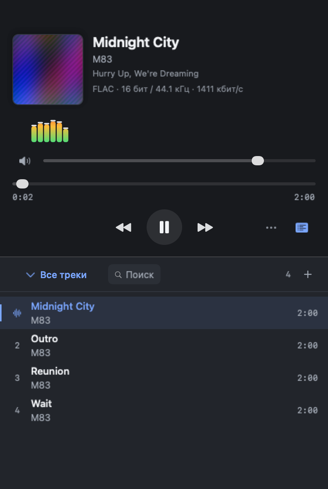

# Cedar Player

[Русский](README.md) · **English**

A compact SwiftUI audio player for macOS: a library with tags and artwork,
playlists, CUE sheets, a built-in DSP equalizer, a spectrum visualizer, Now Playing
and media keys. All code and graphics are original; third-party players and their
resources are not used.



## Features

**Playback**
- MP3, AAC/M4A, ALAC, WAV, AIFF, FLAC, CAF — anything Core Audio can decode.
- Ogg Vorbis, Opus and WavPack via built-in decoders and tag readers; the
  first playback caches the track as ALAC. WavPack with CUE plays as one file
  with cue segments.
- DSF (DSD64–256) through DoP and a separate bit-perfect CoreAudio output:
  hog mode, integer format, no volume, EQ or crossfade. Requires a DAC that
  supports the DoP carrier rate; stereo DSF only. Uncompressed DFF is supported; DST compression is not.
- Speed 0.5×–2×, shuffle, repeat (off / list / one track), mute.
- Restores the last track and position on launch.
- Smooth transitions: fade-out at the end and fade-in at the start of a track (0 / 0.5 / 1 / 2 s).
- Gapless: with crossfade off, automatic transitions do not fade the end or the
  beginning — tracks join without a second of silence. The remaining scheduling
  gap is about 15 ms (measured by `--gapless`) and is inaudible.
- True crossfade: two `AVAudioPlayerNode` instances feed a shared mixer, and the
  next track overlaps the current one (2 / 4 / 6 s, off by default). During the
  crossfade levels are recalculated at 30 Hz, the old track leaves linearly and
  the new one enters; seeking, pausing and manual switching cancel the transition.
- ReplayGain leveling: `REPLAYGAIN_TRACK_GAIN`/`PEAK` in FLAC and `TXXX` in ID3,
  with a separate gain node before the mixer. Boost is limited to +6 dB and the
  track peak; enable it in Settings or via “More → Volume leveling”.

**Tags, artwork, editing**
- Built-in parsers: FLAC (STREAMINFO, Vorbis comments, PICTURE), ID3v2.2/2.3/2.4,
  ID3v1, APE tags (including artwork), RIFF INFO and the `ID3 ` chunk in WAV/AIFF,
  with AVFoundation as a fallback for m4a/aac; folder artwork (`cover`, `folder`, `front`, `album`).
- Tags provide title, artist, album, album artist, track and disc number, genre,
  year, composer and ReplayGain; all of it is shown in the track tooltip and the
  progress bar.
- Tag writing (⌘T): FLAC and MP3 (ID3v2.4), including genre, year and composer;
  APIC artwork is preserved, audio data is not re-encoded, and writes are atomic.
- Automatic artwork search on import (enabled in Settings): tracks without an
  image are looked up in iTunes/Deezer by album and artist, and the result is
  applied to every track in the album.
- Artwork search in external databases: the magnifier on empty artwork, context
  menus, “More → Find artwork…”. Sources are the iTunes Search API and Deezer;
  results can be applied to the whole album and embedded into the file
  (FLAC `PICTURE`, MP3 `APIC`).
- On-disk artwork cache keyed by SHA-256: `library.json` stores only keys, and
  identical images share one file.

**CUE**
- `.cue` parsing (FILE/TRACK/INDEX/PERFORMER/TITLE): one audio file becomes
  segment tracks using `startFrame/endFrame`, without duplicating the file.

**Library**
- File and folder import, drag & drop, search, sorting, playlists.
- Library filters by genre, year, format and quality, plus bulk actions for
  selected tracks.
- “Play Next” and “Add to Queue” with a separate queue window, removal and
  persistence between launches.
- A folder dropped on “New playlist”, or into the window with no playlist
  selected, creates a playlist named after the folder; dropping it on an empty
  playlist with a placeholder name renames that playlist. The playlist menu
  contains “Rename”, “Clear” and “Delete”; clearing and deleting never touch
  files or library entries.
- When a playlist is selected, import and drag & drop add tracks straight into
  it (previously they went only into “All Tracks”).
- Watched folders: selected directories are observed through `DispatchSource`,
  and new audio files are added automatically after a 1.5 s delay so partially
  written files are not picked up.
- Robust import: empty and broken files are skipped, duplicates are not added,
  and a report such as `Added: N · duplicates: M · unreadable: …` is shown;
  import can be cancelled.
- Library window: list and album grid (grouped by album and album artist,
  tracks ordered by number, artwork from the first track that has it).
- Missing files are not dropped from the library: they are marked on load,
  shown in grey with a warning icon, and a double-click opens a new-path picker
  (“Find file…”); ratings and artwork are preserved. The “Check library files”
  menu item refreshes the marks after a disk is connected.

**Equalizer and meters**
- Built-in DSP: a peaking-biquad cascade per channel through `vDSP_biquadm` in
  an `AUAudioUnit`, without resampling; 10 bands from 32 Hz to 16 kHz, ±30 dB,
  preamp ±15 dB.
- Presets and settings persisted between launches.
- Visualizer with 4 styles: segments, bars, LED dots and FFT spectrum (1024
  points, 48 bands) with peaks and a gradient; clicking the visualizer changes
  the style.
- Separate analog VU meter window: two calibrated L/R meters, 0 VU = −12 dBFS,
  scale −20…+3 VU, 300 ms ballistics (single-pole smoothing of raw RMS), a red
  zone from 0 VU and an LED that lights together with the needle in that zone
  (no peak desync); readings in VU. No volume control here.

**Audio output**
- Output device selection in Settings (CoreAudio, UID persisted). Switching
  restarts the engine and playback continues from the same position.
- Shows the real device format: sample rate, bit depth and channel count
  (`48 kHz · 32 bit · 2 ch.`), both in Settings and in the progress-bar tooltip.

**System integration**
- Now Playing: title, artist, album, number, duration, position, rate and artwork.
- Media keys and remote: play/pause, next/previous, seek, stop.
- Menu bar player: track and artist, back/play/forward, output format,
  “Open player” and “Quit”.
- Dock menu: play/pause, next and previous track, show player.
- Interface language: system, Russian or English (“Settings → Language”).
- Update check on launch through the public GitHub Releases feed; can be
  disabled in Settings.
- Artwork, lyrics (`.lrc`) and Settings windows; opening files from Finder.
- Online radio: stations (name + URL) are stored in the library and played
  through `AVPlayer`; play/pause works from the remote and media keys, and Now
  Playing shows the station name; there is no seeking for a stream (shown as
  “Live” instead).
- Station logos: you can provide an image URL when adding a station; otherwise
  `apple-touch-icon.png`, `favicon.ico` and `logo.png` are looked up on the host.
  The logo is cached by SHA-256 and shown in the sidebar, main player and mini player.
- ICY metadata: a separate connection with `Icy-MetaData: 1` retrieves
  `StreamTitle`; an “artist - track” string is split in two (only a hyphen
  surrounded by spaces is a separator, so `Jay-Z` stays a name), shown on two
  lines and published to Now Playing as track, artist and station-as-album.
- Buffering is shown in the station line; on a drop the player reconnects
  automatically (up to three attempts with a 3 s pause). If the stream never
  starts, the player error line reports it.
- Mini player: a spinning vinyl with artwork at 33⅓ rpm (like a record; it
  stops when paused), title and artist, a thin progress bar with time, and
  back / play / forward. Colors and buttons match the main player; the window is
  320×96 by default, 286×92 minimum, and resizes from the corner. While the mini
  player is open the main window is hidden; a button in the top-right corner
  returns to the normal mode (and closes the mini player).

## Installation

### Ready-to-use build

Built versions are available in [Releases](https://github.com/andfriden/CedarPlayer/releases).
Download `CedarPlayer-<version>.dmg`, open the image and drag
`Cedar Player.app` onto the “Applications” shortcut — the app will be installed
immediately. If the release was built without a Developer ID certificate, macOS
shows a warning: open the app via right-click → “Open”, or remove the quarantine
flag with `xattr -dr com.apple.quarantine "/Applications/Cedar Player.app"`.

A `.sha256` file is published next to the DMG; verify it with:

```bash
shasum -a 256 -c CedarPlayer-1.2.0.dmg.sha256
```

A zip archive is also included for those who prefer to unpack manually.

### From source

Requirements: macOS 13+, Xcode 15+ (tested with Swift 6.3.2).

```bash
git clone git@github.com:andfriden/CedarPlayer.git
cd CedarPlayer
./build.sh                     # release build -> build/Cedar Player.app
open "build/Cedar Player.app"
```

The build is a SwiftPM package without external dependencies; `build.sh` builds
the `.app`, copies `Info.plist` and `Resources/AppIcon.icns`, and signs it ad-hoc.
The version comes from `CEDAR_VERSION` and the build number from `CEDAR_BUILD`;
otherwise the commit count is used. Code comments and new commit messages are in English.

The icon is drawn in code (a dark rounded square, a blue crown and a play glyph):

```bash
swift Scripts/make-icon.swift Resources/AppIcon   # PNG + .iconset
iconutil -c icns Resources/AppIcon.iconset -o Resources/AppIcon.icns
```

## Release

```bash
Scripts/package-release.sh 1.2.0   # build, dist/CedarPlayer-1.2.0.dmg/.zip and .sha256
```

A `v*` tag (for example, `v1.2.0`) triggers `.github/workflows/release.yml`:
build, packaging and GitHub Release publication. If the repository secrets
`MACOS_CERTIFICATE`, `MACOS_CERTIFICATE_PASSWORD`, `KEYCHAIN_PASSWORD`,
`CEDAR_SIGN_IDENTITY`, `APPLE_ID`, `APPLE_TEAM_ID` and `APPLE_APP_PASSWORD` are
set, the app is signed with Developer ID and notarized
(`Scripts/sign-and-notarize.sh`). Without secrets the signing step is skipped and
the archive remains ad-hoc.

## Keyboard shortcuts

| Action | Keys |
|---|---|
| Play/pause | `Space` |
| Next / previous track | `⌘→` / `⌘←` |
| Volume up / down / mute | `⌘↑` / `⌘↓` / `⇧⌘M` |
| Shuffle | `⇧⌘S` |
| Equalizer | `⌘E` |
| Lyrics | `⌘L` |
| Mini player | `⌥⌘M` |
| VU meter | `⌘U` |
| Add files | `⌘O` |
| Artwork window | `⇧⌘P` |
| Playlist | `⌥⌘P` |
| Library | `⌘B` |
| Edit tags | `⌘T` |
| Undo removal | `⌥⌘Z` |
| Rate current track | `⌥1`…`⌥5`, clear with `⌥0` |
| Select track in list / play | `↑` `↓` / `Enter` |
| Cancel import | “Controls” menu |

Repeat, speed, meter style and service windows live in the “More” menu on the pane.

## Tests and CI

```bash
swift test        # XCTest: albums, CUE, ReplayGain, artwork cache, playlist import,
                  # FLAC/MP3 tags, ID3v1, APE, RIFF INFO, radio branch and UI snapshots
```

CI (`.github/workflows/ci.yml`) on `macos-latest`: release build, tests,
`.app` packaging and a CLI check.

UI tests render `PlayerPane`, `PlaylistPane`, `MiniPlayerView`, the equalizer,
VU meter and menu bar through `ImageRenderer` at 2x and verify their sizes and
that the frame is not empty.

CI also generates light and dark snapshots (`--snapshots`), compares them with
the baselines in `Tests/Snapshots` (`--snapshot-compare`, tolerance 10% mean
brightness difference after scaling to 64×64) and uploads the PNGs as an
artifact. Refresh the baselines with:

```bash
.build/debug/CedarPlayer --snapshots Tests/Snapshots
```

## Headless checks

```bash
APP="./build/Cedar Player.app/Contents/MacOS/CedarPlayer"
$APP --selftest /path/track.flac       # engine: duration, seek, EQ, spectrum
$APP --tags /path/track.flac           # tags, genre/year/composer, artwork, ReplayGain
$APP --cuesheet /path/album.cue        # CUE tracks
$APP --segment /path/album.cue 1       # segment playback
$APP --import /path/folder             # import with a report
$APP --albums /path/folder             # album grouping
$APP --playlist-import /path/folder "Name"   # import straight into a new playlist
$APP --writetags /path/track.flac title="Name" artist="Artist" track=3
$APP --cover "M83" "Hurry Up, We're Dreaming"
$APP --embedcover /path/track.flac /path/cover.png
$APP --audiodevices [uid]              # output devices and format, can switch
$APP --doctor                          # library, cache, permissions, settings
$APP --logotest https://host           # station logo lookup
$APP --watchtest /folder /path/track.flac   # auto-add a new file in a folder
$APP --crossfadetest /path/a.flac /path/b.flac   # overlap and track switch
$APP --gapless /path/a.flac /path/b.flac         # seamless join and gap measurement
$APP --radiotest /path/file.mp3        # AVPlayer radio branch
$APP --radiotest https://stream        # ICY metadata and stream errors
$APP --nowplaying /path/track.flac     # Now Playing dictionary and commands
$APP --eqdump                          # saved EQ settings
$APP --bench [--tracks 10000] [--playlist 5000]   # large library query benchmark
```

To experiment without touching the working library, point the app at a separate
directory — both `library.json` and the artwork cache will live there:

```bash
CEDAR_LIBRARY_DIR=/tmp/cedar-test $APP --import /path/folder
```

Window snapshot without screen recording (the window’s own layer is drawn):

```bash
CEDAR_LIBRARY_DIR=/tmp/cedar-test \
CEDAR_WINDOW_SHOT="$PWD/Docs/main-window.png" \
CEDAR_SHOT_TRACK=/path/track.flac \
"$APP" -showPlaylist YES -meterStyle spectrum
```

## Project structure

```
CedarPlayer/
├── Package.swift                 SwiftPM: executable + test target
├── build.sh                      .app build, icon and ad-hoc signing
├── Scripts/make-icon.swift       icon generation (PNG, iconset, icns)
├── Docs/main-window.png          README screenshot
├── Resources/Info.plist          bundle, document types (audio + CUE)
├── Tests/CedarPlayerTests/       XCTest
└── Sources/CedarPlayer/
    ├── CedarPlayerApp.swift      entry point, windows, menus, CLI modes
    ├── Theme.swift               palette, spacing and corner-radius scales
    ├── Track.swift               track model, metadata, quality
    ├── AudioTranscoder.swift     Ogg/Opus/WavPack → ALAC cache
    ├── OggMetadata.swift         Ogg Vorbis tags
    ├── OpusMetadata.swift        Opus tags
    ├── WavPackMetadata.swift     WavPack tags and stream info
    ├── Tags.swift                FLAC/ID3v2, folder artwork
    ├── TagWriter.swift           FLAC and MP3 tag writing
    ├── ReplayGain.swift          value parsing and safe gain
    ├── ArtworkCache.swift        on-disk SHA-256 artwork cache
    ├── AlbumGroup.swift          album grouping
    ├── SmartPlaylist.swift       smart playlist rules
    ├── PlaylistFile.swift        M3U and PLS import/export
    ├── FolderWatcher.swift       folder observation
    ├── AudioDevices.swift        output devices and their format
    ├── RadioStation.swift        online station model
    ├── RadioLogoLoader.swift     station logo lookup and download
    ├── IcyMetadataReader.swift   StreamTitle from an ICY stream
    ├── CueSheet.swift            CUE parser and segments
    ├── PlayerEngine.swift        AVAudioEngine, queue, segments, EQ, state
    ├── BiquadEQAudioUnit.swift   DSP equalizer on vDSP_biquadm
    ├── SpectrumAnalyzer.swift    FFT spectrum
    ├── LevelMeter.swift          RMS/peak per channel
    ├── Library.swift             library, playlists, import, storage
    ├── CoverArtService.swift     artwork search (iTunes, Deezer)
    ├── CoverPickerSheet.swift    found-artwork picker
    ├── TagEditorSheet.swift      tag editor sheet
    ├── NowPlayingService.swift   Now Playing and media commands
    ├── MainWindowView.swift      player + playlist, window sizing
    ├── PlayerPane.swift          player pane 425×300
    ├── PlaylistPane.swift        bottom track list
    ├── MoreMenuButton.swift      AppKit “More” menu
    ├── ContentView.swift         “Library” window
    ├── MeterViews.swift          visualizer styles and VU meter
    ├── EqualizerView.swift       equalizer
    ├── PlayerWindowView.swift    lyrics, mini player
    ├── ArtworkWindowView.swift   artwork window
    └── SettingsView.swift        settings
```

## Performance

List queries are cached in `Library.query` under “filter + search + sorting +
library revision”. The revision grows whenever tracks or playlists change, so
ratings, tag edits and removals invalidate the cache immediately. Search uses a
lowercased index rebuilt once per revision, playlists use a `UUID → Track`
dictionary, and list artwork is decoded through `NSCache` in
`ArtworkCache.image(for:)`.

The library window no longer subscribes to the whole engine: rows and album
cards observe it themselves (`LiveTrackRow`, `LiveAlbumCard`), while actions go
through `EnvironmentValues.player` without a subscription. Playlist-pane search
is applied with a 180 ms delay so the list is not rebuilt on every keystroke.

Benchmark on 10,000 tracks and a 5,000-track playlist (`--bench`, average on this
machine):

| Operation | Before | After |
|---|---:|---:|
| Repeated `visibleTracks` query | 10.8 ms | < 0.01 ms |
| Playlist tracks (5,000) | 5,418 ms | 3.4 ms |
| Search + sort, cold key | 37 ms | 30 ms |

With 50,000 tracks, a 20,000-track playlist is assembled in 17 ms; a cold search
remains expensive (about 155 ms), which the input delay hides.

## Visual system

- Theme: system, forced dark or light (“Settings → Appearance”). The palette is
  adaptive: dark — background `#181A1E`, panels `#22252B`, text `#F2F4F7`,
  secondary `#A2A9B4`, accent `#7BA7FF`, separators `#323740`; light — background
  `#F2F3F5`, panels `#FFFFFF`, text `#1B1F27`, secondary `#5C6472`, accent
  `#3567C8`, separators `#D7DBE2`.
- Spacing 4 / 8 / 12 / 16 / 24, corner radii 6 / 8 / 12.
- Accent is used only for enabled state and the selected item.
- Typography: title 18 pt semibold, list 13 pt medium, artist 12 pt, time and
  technical data 11 pt (monospaced).
- Player pane 425×300, playlist 425×300, window 425×600 or 425×300. No glass or
  heavy shadows.

## Limitations

- No MPC, TTA, DST compression or bit-perfect WavPack DSD: WavPack DSD is
  decoded to PCM. Ogg Opus needs a macOS version whose Core Audio supports Opus.
- No DLNA/UPnP, AirPlay multi-room, CD ripping, ShazamKit, Last.fm, audio/video
  conversion or Apple Music sync.
- Oversampling and bit-perfect output for the equalizer are not implemented.
- Artwork found in online databases is stored in the library but is not embedded
  into the file.
- Tag writing is supported only for FLAC and MP3.
- Ogg Vorbis/Opus/WavPack are fully decoded into the cache on first playback;
  long WavPack albums mean a noticeable delay and disk usage.

## License

MIT — see [LICENSE](LICENSE). The project is educational and the code is original.
