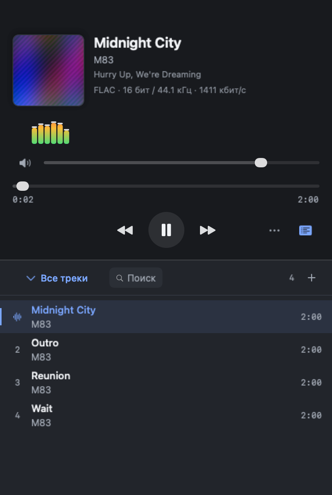

# Cedar Player

**Русский** · [English](README.en.md)

Компактный аудиоплеер для macOS на SwiftUI: библиотека с тегами и обложками,
плейлисты, CUE-образы, свой DSP-эквалайзер, спектральный визуализатор, Now Playing
и медиа-клавиши. Весь код и графика — собственные, сторонние плееры и их ресурсы
не используются.



## Возможности

**Воспроизведение**
- MP3, AAC/M4A, ALAC, WAV, AIFF, FLAC, CAF — всё, что декодирует Core Audio.
- Скорость 0.5×–2×, перемешивание, повтор (выкл. / список / один трек), mute.
- Запоминание последнего трека и позиции при запуске.
- Плавные переходы: затухание в конце и нарастание в начале трека (0 / 0.5 / 1 / 2 с).
- Gapless: при выключенном кроссфейде автоматический переход не гасит конец и не
  нарастает в начале — треки стыкуются без секундной тишины. Остаточный разрыв
  планирования ~15 мс (замер `--gapless`), на слух неразличим.
- Истинный кроссфейд: два `AVAudioPlayerNode` сведены в общий микшер, следующий
  трек входит с наложением (2 / 4 / 6 с, по умолчанию выключен). Во время
  кроссфейда уровни пересчитываются на 30 Гц, старый трек уходит линейно, новый
  приходит; перемотка, пауза и ручное переключение отменяют переход.
- Выравнивание громкости по ReplayGain: `REPLAYGAIN_TRACK_GAIN`/`PEAK` во FLAC и
  `TXXX` в ID3, отдельный узел усиления перед микшером. Буст ограничен +6 дБ и
  пиком трека; включается в настройках или «Ещё → Выравнивать громкость».

**Теги, обложки, правка**
- Свои парсеры: FLAC (STREAMINFO, Vorbis comments, PICTURE), ID3v2.2/2.3/2.4,
  ID3v1, APE-теги (включая обложку), RIFF INFO и чанк `ID3 ` в WAV/AIFF,
  AVFoundation как фолбэк для m4a/aac; обложки из папки (`cover`, `folder`, `front`, `album`).
- Из тегов читаются название, исполнитель, альбом, исполнитель альбома, номер
  трека и диска, жанр, год, композитор, ReplayGain; всё это видно в подсказке
  к треку и в прогресс-баре.
- Запись тегов в файл (⌘T): FLAC и MP3 (ID3v2.4), включая жанр, год и
  композитора; обложка APIC сохраняется, аудиоданные не перекодируются, запись
  атомарная.
- Автопоиск обложек при импорте (включается в настройках): для треков без
  картинки запрос уходит в iTunes/Deezer по альбому и исполнителю, результат
  применяется ко всем трекам альбома.
- Поиск обложки в базах, если её нет: лупа на пустой обложке, контекстные меню,
  «Ещё → Найти обложку…». Источники — iTunes Search API и Deezer, найденное можно
  применить ко всему альбому и встроить в файл (FLAC `PICTURE`, MP3 `APIC`).
- Кэш обложек на диске по SHA-256: в `library.json` только ключи, одинаковые
  картинки занимают один файл.

**CUE**
- Разбор `.cue` (FILE/TRACK/INDEX/PERFORMER/TITLE): один аудиофайл превращается
  в треки-сегменты по `startFrame/endFrame`, без дублирования файла.

**Библиотека**
- Импорт файлов и папок, drag & drop, поиск, сортировка, плейлисты.
- Папка, брошенная на «Новый плейлист» или в окно без выбранного плейлиста,
  создаёт плейлист с именем папки; при броске на пустой плейлист с именем-
  заглушкой он переименовывается. В меню плейлиста — «Переименовать»,
  «Очистить» и «Удалить»; очистка и удаление не трогают файлы и библиотеку.
- Если в плейлисте выбран свой список, импорт и перетаскивание добавляют треки
  сразу в него (раньше они попадали только в «Все треки»).
- Папки наблюдения: выбранные каталоги отслеживаются через `DispatchSource`,
  новые аудиофайлы добавляются в библиотеку автоматически (с задержкой 1.5 с,
  чтобы не ловить недописанные файлы).
- Устойчивый импорт: пустые и битые файлы пропускаются, дубликаты не добавляются,
  отчёт вида `Добавлено: N · дубликатов: M · не читается: …`; импорт можно прервать.
- Окно «Библиотека»: список и сетка альбомов (группировка по альбому и
  исполнителю альбома, треки по номеру, обложка из первого трека с картинкой).
- Пропавшие файлы не выбрасываются из библиотеки: при загрузке они помечаются,
  показываются серыми со значком, двойной клик открывает выбор нового пути
  («Найти файл…»), оценки и обложка сохраняются. Пункт меню «Проверить файлы
  библиотеки» обновляет пометки после подключения диска.

**Эквалайзер и индикаторы**
- Свой DSP: каскад peaking-biquad на канал через `vDSP_biquadm` в `AUAudioUnit`,
  без ресемплинга; 10 полос 32 Гц – 16 кГц, ±30 дБ, предусилитель ±15 дБ.
- Пресеты, сохранение настроек между запусками.
- Визуализатор 4 стилей: сегменты, полосы, LED-точки, FFT-спектр (1024 точки,
  48 полос) с пиками и градиентом; клик по визуализатору меняет стиль.
- Отдельное окно аналогового VU-метра: два калиброванных прибора L/R,
  0 VU = −12 dBFS, шкала −20…+3 VU, баллистика 300 мс (одно-полюсное сглаживание
  сырого RMS), красная зона от 0 VU и LED, загорающийся вместе со стрелкой в этой
  зоне (без рассинхрона по пику), показания в VU. Громкости здесь нет.

**Вывод звука**
- Выбор выходного устройства в настройках (CoreAudio, UID сохраняется). При
  переключении движок перезапускается и воспроизведение продолжается с той же
  позиции.
- Показывается реальный формат устройства: частота, битность и число каналов
  (`48 кГц · 32 бит · 2 кан.`), в настройках и в подсказке к прогресс-бару.

**Системная интеграция**
- Now Playing: название, исполнитель, альбом, номер, длительность, позиция,
  скорость, обложка.
- Медиа-клавиши и пульт: play/pause, вперёд/назад, перемотка, stop.
- Плеер в строке меню: трек и исполнитель, назад/play/вперёд, формат вывода,
  «Открыть плеер» и «Выход».
- Dock-меню: воспроизвести/пауза, следующий и предыдущий трек, показать плеер.
- Окна обложки, текста песни (`.lrc`), настроек; открытие файлов из Finder.
- Онлайн-радио: станции (имя + URL) хранятся в библиотеке, запускаются через
  `AVPlayer`; play/pause работают с пульта и медиа-клавиш, Now Playing показывает
  название станции, перемотки для потока нет (вместо неё «Прямой эфир»).
- Логотипы станций: при добавлении можно указать URL картинки, иначе ищутся
  `apple-touch-icon.png`, `favicon.ico` и `logo.png` на хосте. Логотип кэшируется
  по SHA-256 и показывается в сайдбаре, основном и мини-плеере.
- ICY-метаданные: отдельное соединение с `Icy-MetaData: 1` вытаскивает
  `StreamTitle`; строку «исполнитель - трек» плеер делит на две (разделитель —
  только дефис с пробелами, поэтому `Jay-Z` остаётся именем), показывает в двух
  строках и отдаёт в Now Playing: трек, исполнитель, станция как альбом.
- Буферизация показывается в строке станции, при обрыве плеер сам переподключается
  (до трёх попыток с паузой 3 с); если поток так и не поднялся — ошибка в строке
  ошибки плеера.
- Мини-плеер: вращающаяся «пластинка» с обложкой на 33⅓ об/мин (как винил;
  на паузе замирает), название и исполнитель,
  тонкий прогресс с временем, назад / play / вперёд. Цвета и кнопки — как в
  основном плеере; окно 320×96 по умолчанию, минимум 286×92, тянется за угол.
  Пока мини-плеер открыт, главное окно скрыто; кнопка в правом верхнем углу
  возвращает в обычный режим (и закрывает мини-плеер).

## Установка

### Готовый архив

Собранные версии — в [Releases](https://github.com/andfriden/CedarPlayer/releases).
Скачайте `CedarPlayer-<версия>.dmg`, откройте образ и перетащите
`Cedar Player.app` на ярлык «Applications» — приложение сразу окажется
в «Программах». Если релиз собран без сертификата Developer ID, macOS покажет
предупреждение: откройте приложение через правый клик → «Открыть» либо снимите
карантин командой `xattr -dr com.apple.quarantine "/Applications/Cedar Player.app"`.

Рядом с DMG лежит `.sha256`; проверка:

```bash
shasum -a 256 -c CedarPlayer-1.1.0.dmg.sha256
```

В релизе также остаётся zip-архив для тех, кому удобнее распаковать вручную.

### Из исходников

Требования: macOS 13+, Xcode 15+ (проверено на Swift 6.3.2).

```bash
git clone git@github.com:andfriden/CedarPlayer.git
cd CedarPlayer
./build.sh                     # релизная сборка -> build/Cedar Player.app
open "build/Cedar Player.app"
```

Сборка — SwiftPM-пакет без внешних зависимостей; `build.sh` собирает `.app`,
кладёт `Info.plist`, иконку `Resources/AppIcon.icns` и подписывает ad-hoc.
Комментарии в коде и новые сообщения коммитов — на английском.
Версия задаётся `CEDAR_VERSION`, номер сборки — `CEDAR_BUILD`, иначе берётся
количество коммитов.

Иконка рисуется кодом (тёмный скруглённый квадрат, голубая крона и значок play):

```bash
swift Scripts/make-icon.swift Resources/AppIcon   # PNG + .iconset
iconutil -c icns Resources/AppIcon.iconset -o Resources/AppIcon.icns
```

## Релиз

```bash
Scripts/package-release.sh 1.1.0   # сборка, dist/CedarPlayer-1.1.0.dmg/.zip и .sha256
```

Тег `v*` (например, `v1.1.0`) запускает `.github/workflows/release.yml`: сборка, упаковка и
публикация GitHub Release. Если в секретах репозитория заданы
`MACOS_CERTIFICATE`, `MACOS_CERTIFICATE_PASSWORD`, `KEYCHAIN_PASSWORD`,
`CEDAR_SIGN_IDENTITY`, `APPLE_ID`, `APPLE_TEAM_ID` и `APPLE_APP_PASSWORD`,
приложение подписывается Developer ID и нотаризуется (`Scripts/sign-and-notarize.sh`).
Без секретов шаг подписи пропускается, архив остаётся ad-hoc.

## Горячие клавиши

| Действие | Клавиши |
|---|---|
| Воспроизвести/пауза | `Пробел` |
| Следующий / предыдущий трек | `⌘→` / `⌘←` |
| Громче / тише / mute | `⌘↑` / `⌘↓` / `⇧⌘M` |
| Перемешивание | `⇧⌘S` |
| Эквалайзер | `⌘E` |
| Текст песни | `⌘L` |
| Мини-плеер | `⌥⌘M` |
| VU-метр | `⌘U` |
| Добавить файлы | `⌘O` |
| Окно обложки | `⇧⌘P` |
| Плейлист | `⌥⌘P` |
| Библиотека | `⌘B` |
| Правка тегов | `⌘T` |
| Отменить удаление | `⌥⌘Z` |
| Оценка текущего трека | `⌥1`…`⌥5`, снять — `⌥0` |
| Выбор трека в списке / играть | `↑` `↓` / `Enter` |
| Отменить импорт | меню «Управление» |

Повтор, скорость, стиль индикатора и сервисные окна — в меню «Ещё» на панели.

## Тесты и CI

```bash
swift test        # XCTest: альбомы, CUE, ReplayGain, кэш обложек, импорт в плейлист,
                  # теги FLAC/MP3, ID3v1, APE, RIFF INFO, радио-ветка и снимки UI
```

CI (`.github/workflows/ci.yml`) на `macos-latest`: release-сборка, тесты,
упаковка `.app` и проверка CLI.

UI-тесты рисуют `PlayerPane`, `PlaylistPane`, `MiniPlayerView`, эквалайзер,
VU-метр и меню-бар через `ImageRenderer` в двойном разрешении и проверяют
размеры и непустоту кадра.

CI дополнительно генерирует набор снимков (`--snapshots`) в светлой и тёмной
темах, сравнивает их с эталонами `Tests/Snapshots` (`--snapshot-compare`,
допуск 10 % средней разницы яркости после приведения к 64×64) и выкладывает
PNG артефактом. Эталоны обновляются командой:

```bash
.build/debug/CedarPlayer --snapshots Tests/Snapshots
```

## Проверка без интерфейса

```bash
APP="./build/Cedar Player.app/Contents/MacOS/CedarPlayer"
$APP --selftest /путь/трек.flac        # движок: длительность, seek, EQ, спектр
$APP --tags /путь/трек.flac            # теги, жанр/год/композитор, обложка, ReplayGain
$APP --cuesheet /путь/album.cue        # треки CUE
$APP --segment /путь/album.cue 1       # воспроизведение сегмента
$APP --import /путь/папка              # импорт с отчётом
$APP --albums /путь/папка              # группировка по альбомам
$APP --playlist-import /путь/папка "Имя"   # импорт сразу в новый плейлист
$APP --writetags /путь/трек.flac title="Имя" artist="Кто" track=3
$APP --cover "M83" "Hurry Up, We're Dreaming"
$APP --embedcover /путь/трек.flac /путь/обложка.png
$APP --audiodevices [uid]              # устройства вывода и формат, можно переключить
$APP --doctor                          # библиотека, кэш, права, настройки
$APP --logotest https://хост           # поиск логотипа станции
$APP --watchtest /папка /путь/трек.flac  # автодобавление нового файла в папке
$APP --crossfadetest /путь/a.flac /путь/b.flac   # наложение и смена трека
$APP --gapless /путь/a.flac /путь/b.flac         # стык без фейдов и замер разрыва
$APP --radiotest /путь/файл.mp3        # радио-ветка AVPlayer
$APP --radiotest https://поток          # ICY-метаданные и ошибки потока
$APP --nowplaying /путь/трек.flac      # словарь Now Playing и команды
$APP --eqdump                          # сохранённые настройки EQ
$APP --bench [--tracks 10000] [--playlist 5000]   # замер выборок большой библиотеки
```

Для экспериментов без риска для рабочей библиотеки задайте отдельный каталог —
туда пойдут и `library.json`, и кэш обложек:

```bash
CEDAR_LIBRARY_DIR=/tmp/cedar-test $APP --import /путь/папка
```

Скриншот окна без записи экрана (рисуется собственный слой окна):

```bash
CEDAR_LIBRARY_DIR=/tmp/cedar-test \
CEDAR_WINDOW_SHOT="$PWD/Docs/main-window.png" \
CEDAR_SHOT_TRACK=/путь/трек.flac \
"$APP" -showPlaylist YES -meterStyle spectrum
```

## Структура

```
CedarPlayer/
├── Package.swift                 SwiftPM: executable + test target
├── build.sh                      сборка .app, иконка и ad-hoc подпись
├── Scripts/make-icon.swift       генерация иконки (PNG, iconset, icns)
├── Docs/main-window.png          скриншот для README
├── Resources/Info.plist          бандл, типы документов (аудио + CUE)
├── Tests/CedarPlayerTests/       XCTest
└── Sources/CedarPlayer/
    ├── CedarPlayerApp.swift      точка входа, окна, меню, CLI-режимы
    ├── Theme.swift               палитра, шкалы отступов и скруглений
    ├── Track.swift               модель трека, метаданные, качество
    ├── Tags.swift                FLAC/ID3v2, обложки из папки
    ├── TagWriter.swift           запись тегов FLAC и MP3
    ├── ReplayGain.swift          разбор значений и безопасное усиление
    ├── ArtworkCache.swift        дисковый кэш обложек по SHA-256
    ├── AlbumGroup.swift          группировка по альбомам
    ├── SmartPlaylist.swift       правила умных подборок
    ├── PlaylistFile.swift        импорт/экспорт M3U и PLS
    ├── FolderWatcher.swift       наблюдение за папками
    ├── AudioDevices.swift        устройства вывода и их формат
    ├── RadioStation.swift        модель онлайн-станции
    ├── RadioLogoLoader.swift     поиск и загрузка логотипа станции
    ├── IcyMetadataReader.swift   StreamTitle из ICY-потока
    ├── CueSheet.swift            парсер CUE и сегменты
    ├── PlayerEngine.swift        AVAudioEngine, очередь, сегменты, EQ, состояние
    ├── BiquadEQAudioUnit.swift   DSP-эквалайзер на vDSP_biquadm
    ├── SpectrumAnalyzer.swift    FFT-спектр
    ├── LevelMeter.swift          RMS/пик по каналам
    ├── Library.swift             библиотека, плейлисты, импорт, хранение
    ├── CoverArtService.swift     поиск обложек (iTunes, Deezer)
    ├── CoverPickerSheet.swift    выбор найденной обложки
    ├── TagEditorSheet.swift      лист правки тегов
    ├── NowPlayingService.swift   Now Playing и медиа-команды
    ├── MainWindowView.swift      плеер + плейлист, размеры окна
    ├── PlayerPane.swift          панель плеера 425×300
    ├── PlaylistPane.swift        нижний список треков
    ├── MoreMenuButton.swift      меню «Ещё» на AppKit
    ├── ContentView.swift         окно «Библиотека»
    ├── MeterViews.swift          стили визуализатора и VU-метр
    ├── EqualizerView.swift       эквалайзер
    ├── PlayerWindowView.swift    текст песни, мини-плеер
    ├── ArtworkWindowView.swift   окно обложки
    └── SettingsView.swift        настройки
```

## Производительность

Выборка списка кэшируется в `Library.query` по ключу «фильтр + поиск +
сортировка + ревизия библиотеки». Ревизия растёт при изменении треков или
плейлистов, поэтому оценки, правка тегов и удаление сразу сбрасывают кэш.
Для поиска один раз на ревизию строится нижнерегистровый индекс, для
плейлистов — словарь `UUID → Track`, а обложки списков декодируются через
`NSCache` в `ArtworkCache.image(for:)`.

Окно библиотеки больше не подписано на движок целиком: строки и карточки
альбомов наблюдают его сами (`LiveTrackRow`, `LiveAlbumCard`), а действия
идут через `EnvironmentValues.player` без подписки. Поиск в панели плейлиста
применяется с задержкой 180 мс, чтобы не пересобирать список на каждый символ.

Замер на 10 000 треках и плейлисте из 5 000 (`--bench`, среднее на этой машине):

| Операция | До | После |
|---|---:|---:|
| Повторная выборка `visibleTracks` | 10.8 мс | < 0.01 мс |
| Треки плейлиста (5 000) | 5 418 мс | 3.4 мс |
| Поиск + сортировка, холодный ключ | 37 мс | 30 мс |

На 50 000 треках треки плейлиста из 20 000 собираются за 17 мс; холодный
поиск остаётся дорогим (около 155 мс), его скрывает задержка ввода.

## Визуальная система

- Тема: системная, принудительно тёмная или светлая («Настройки → Оформление»).
  Палитра адаптивная: тёмная — фон `#181A1E`, панели `#22252B`, текст `#F2F4F7`,
  вторичный `#A2A9B4`, акцент `#7BA7FF`, разделители `#323740`; светлая — фон
  `#F2F3F5`, панели `#FFFFFF`, текст `#1B1F27`, вторичный `#5C6472`, акцент
  `#3567C8`, разделители `#D7DBE2`.
- Отступы 4 / 8 / 12 / 16 / 24, скругления 6 / 8 / 12.
- Акцент — только включённое состояние и выбранный элемент.
- Типографика: название 18 pt semibold, список 13 pt medium, исполнитель 12 pt,
  время и техданные 11 pt (моноширинно).
- Панель плеера 425×300, плейлист 425×300, окно 425×600 или 425×300.
  Стекло и тяжёлые тени не используются.

## Ограничения

- Нет Ogg/Opus/WavPack/MPC/TTA/DSD: в Core Audio нет декодеров.
- Нет DLNA/UPnP, AirPlay-мультирум, CD-рипинга, ShazamKit, Last.fm, конвертации
  аудио и видео, синхронизации с Apple Music.
- Oversampling и bit-perfect вывод для эквалайзера не реализованы.
- Обложки, найденные в базах, сохраняются в библиотеке, но не встраиваются в файл.
- Запись тегов поддерживается только для FLAC и MP3.

## Лицензия

MIT — см. [LICENSE](LICENSE). Проект учебный, код собственный.
